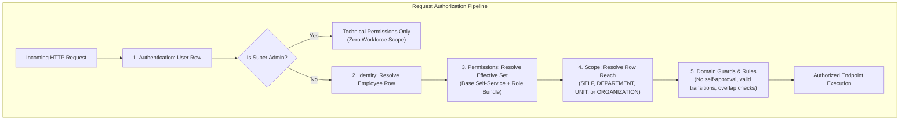
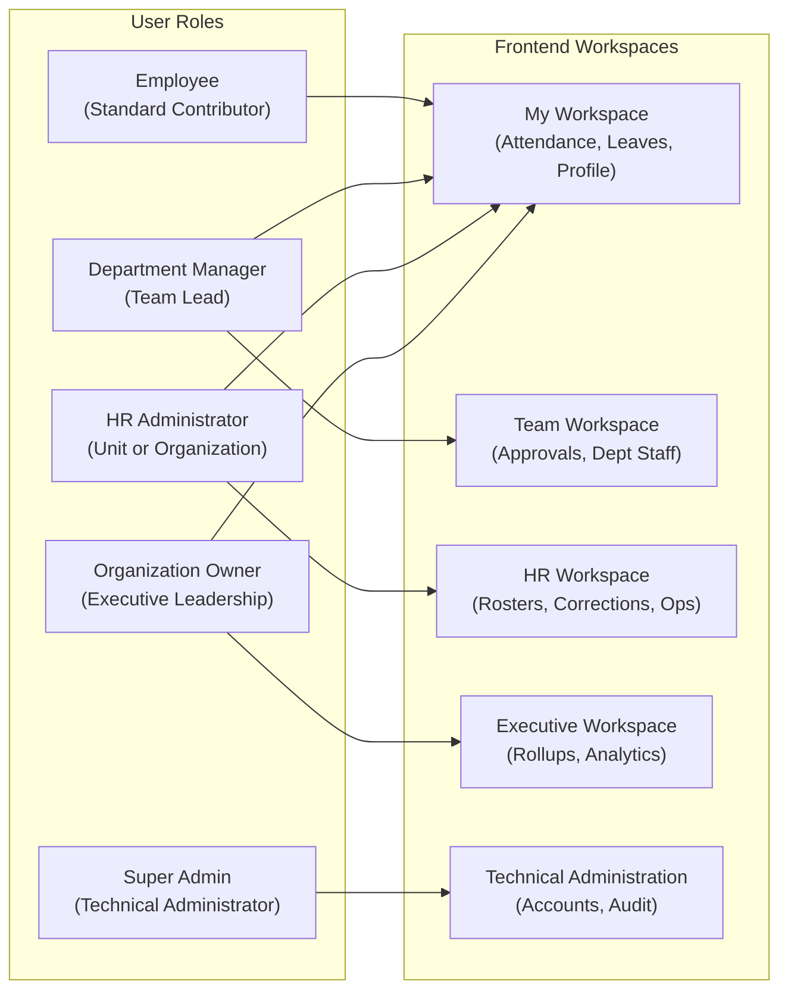
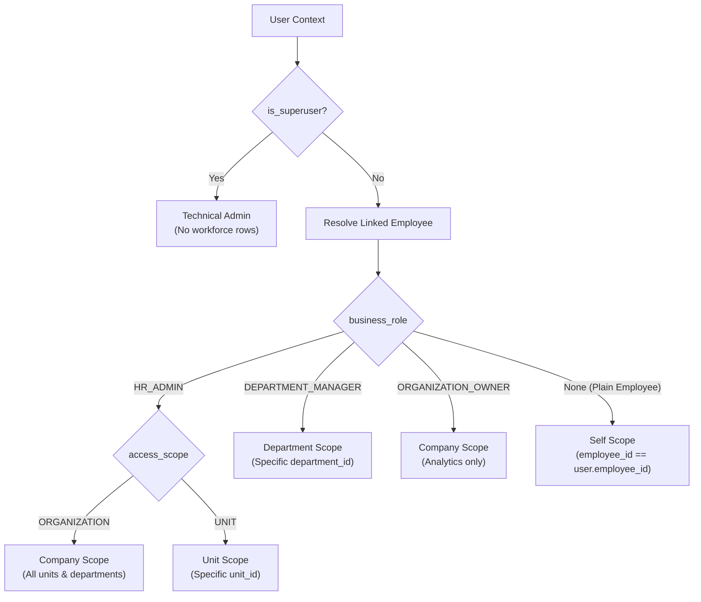
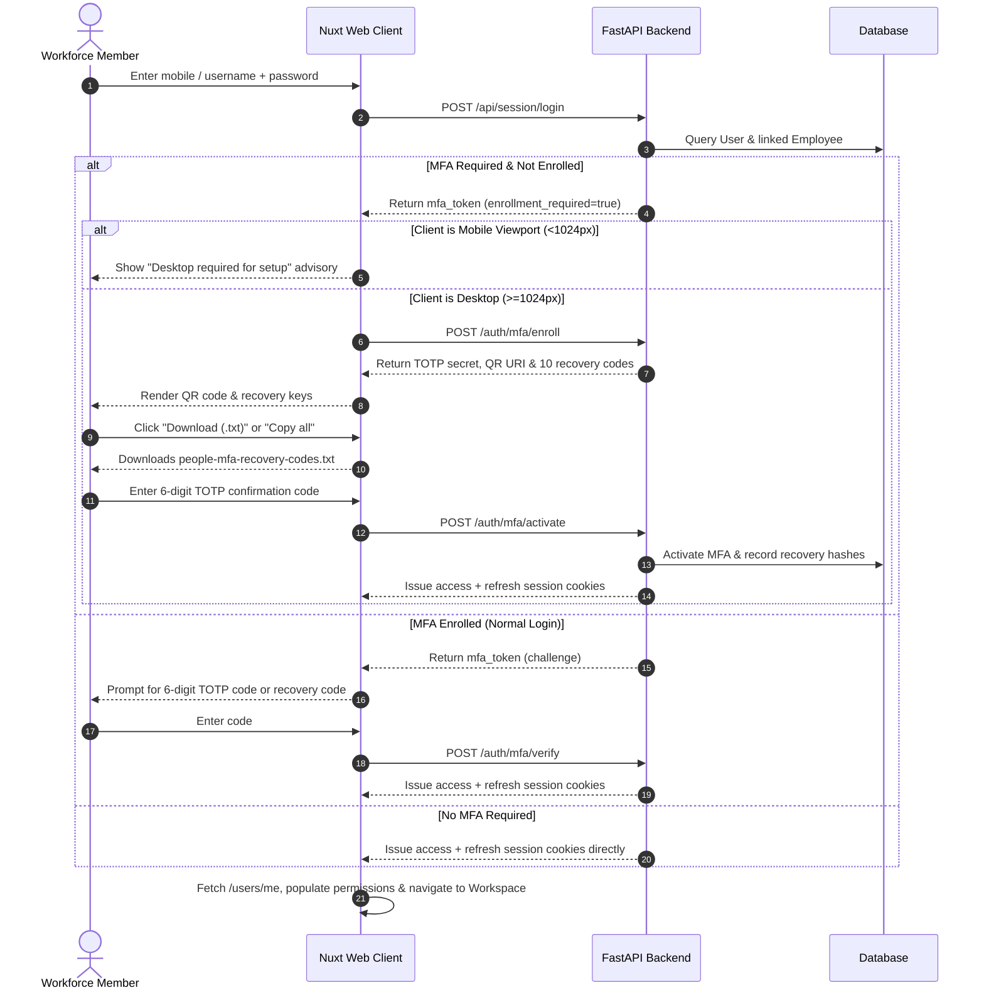
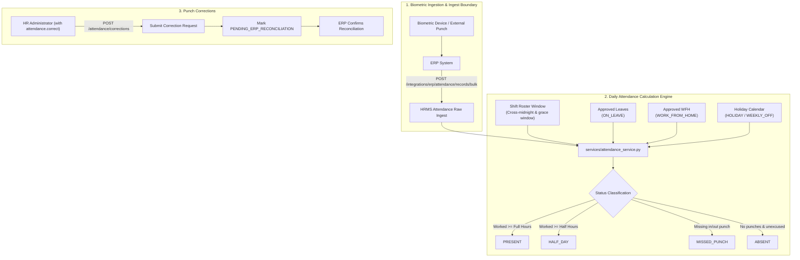
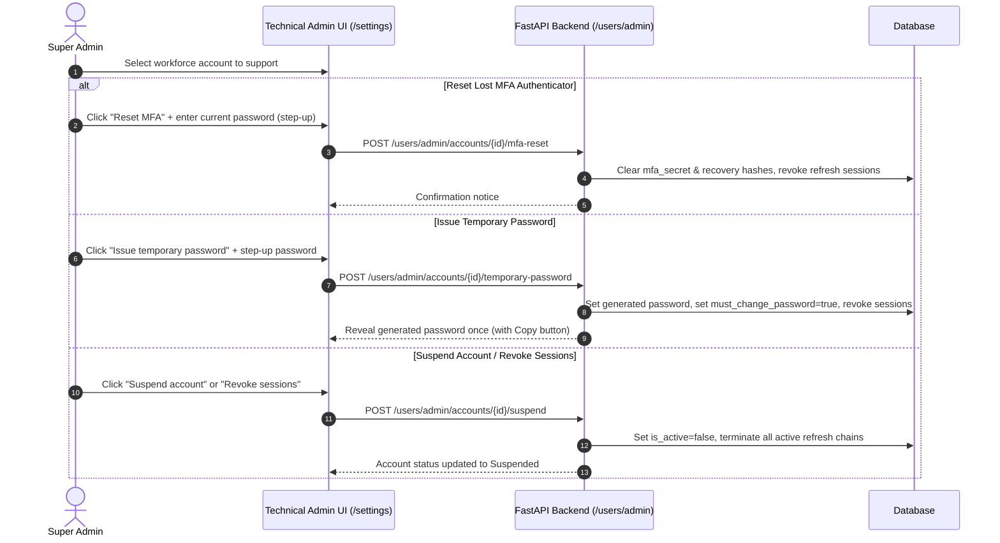

# User Roles, Permissions, Scopes & Workflows

This document is the comprehensive reference for authorization, access control, and end-to-end operational workflows across People HRMS.

---

## 1. Core Authorization Model

People HRMS separates authorization into **four orthogonal concepts**. An employee holds **at most one** elevated business role, and permissions are additive (base self-service set + optional role bundle):



> [!IMPORTANT]
> **No per-user overrides or role-assignment tables:** Permissions are not assigned directly to users or stored as flags. Authorization is re-evaluated dynamically on every request by querying the database, so role and scope changes apply immediately without waiting for session expiry.

---

## 2. The 5 User Roles & Workspace Mapping



| Role | Business Responsibility | Access Scope | Login Door | Workspaces Available |
|---|---|---|---|---|
| **EMPLOYEE** | Standard individual contributor self-service | `SELF` (own records only) | `/login` (Mobile or Username) | **My Workspace** |
| **DEPARTMENT_MANAGER** | Team lead managing one department's attendance, leaves, approvals & overtime | `DEPARTMENT` (department_id) | `/login` (Mobile or Username) | **My Workspace**, **Team Workspace** |
| **HR_ADMIN (Unit)** | People operations manager for a specific factory, branch, or business unit | `UNIT` (unit_id) | `/login` (Mobile or Username) | **My Workspace**, **HR Workspace** |
| **HR_ADMIN (Org)** | Central corporate HR director overseeing all company units | `ORGANIZATION` (all units) | `/login` (Mobile or Username) | **My Workspace**, **HR Workspace** |
| **ORGANIZATION_OWNER** | Executive leadership / C-Suite reviewing org health, attendance & overtime | `ORGANIZATION` (read/analytics only) | `/login` (Mobile or Username) | **My Workspace**, **Executive Workspace** |
| **SUPER_ADMIN** | Host-level technical administrator managing credentials, MFA resets & system audit | *N/A (No workforce row access)* | `/admin/login` (Username only) | **Technical Administration** |

### 2.1 Multi-Window Manual Testing Credentials Cheat-Sheet

To test the system end-to-end (e.g. Employee requests leave in Window 1 ➔ Manager approves in Window 2 ➔ HR audits in Window 3 ➔ Owner views metrics in Window 4), open multiple browser windows or private/incognito tabs and log into these pre-configured personas.

The seed data provisions **at least 2 direct report employees in each department**, making it easy to test team views, multi-item approval queues, and cross-department privacy boundaries:

| Persona | Role | Scope | Department / Unit | Username | Mobile Number | Reports To | Pre-Wired Test State |
|---|---|---|---|---|---|---|---|
| **CEO / Org Owner** | `ORGANIZATION_OWNER` | `ORGANIZATION` | Executive (`ENG-HYD`) | `rajesh.sharma` | `+919810101010` | *(None)* | Executive rollups & cross-unit KPIs |
| **HR Director** | `HR_ADMIN` | `ORGANIZATION` | HR (`HR-HYD`) | `priya.nair` | `+919820202020` | `rajesh.sharma` | Company-wide workforce & policy management |
| **Hyderabad HRBP** | `HR_ADMIN` | `UNIT` | HR (`HR-HYD`) | `suresh.reddy` | `+919840404040` | `priya.nair` | Unit operations (manages Kavya & Arun) |
| **Engineering Mgr** | `DEPARTMENT_MANAGER` | `DEPARTMENT` | Engineering (`ENG-HYD`) | `vikram.malhotra` | `+919850505050` | `rajesh.sharma` | Team approvals inbox (Rahul & Neha pending) |
| **Bengaluru HRBP** | `HR_ADMIN` | `UNIT` | HR (`HR-BLR`) | `ananya.iyer` | `+919830303030` | `priya.nair` | Unit operations (manages Pooja & Deepak) |
| **Platform Mgr** | `DEPARTMENT_MANAGER` | `DEPARTMENT` | Engineering (`ENG-BLR`) | `rohit.verma` | `+919860606060` | `rajesh.sharma` | Team approvals inbox (Priya pending; Rahul hidden) |
| **Sr. Software Eng** | `EMPLOYEE` | `SELF` | Engineering (`ENG-HYD`) | `rahul.sharma` | `+919876543210` | `vikram.malhotra` | 1 PENDING leave, 1 PENDING correction, 1 WFH |
| **Software Eng** | `EMPLOYEE` | `SELF` | Engineering (`ENG-HYD`) | `neha.gupta` | `+919876543211` | `vikram.malhotra` | 1 PENDING Sick Leave |
| **HR Operations** | `EMPLOYEE` | `SELF` | HR (`HR-HYD`) | `kavya.nair` | `+919876543212` | `suresh.reddy` | Self-service attendance & leave balances |
| **HR Operations** | `EMPLOYEE` | `SELF` | HR (`HR-HYD`) | `arun.kumar` | `+919876543213` | `suresh.reddy` | Self-service attendance & leave balances |
| **Sr. Software Eng** | `EMPLOYEE` | `SELF` | Engineering (`ENG-BLR`) | `priya.verma` | `+919876543214` | `rohit.verma` | 1 PENDING leave (hidden from Vikram) |
| **Software Eng** | `EMPLOYEE` | `SELF` | Engineering (`ENG-BLR`) | `amit.patel` | `+919876543215` | `rohit.verma` | Self-service attendance & leave balances |
| **HR Operations** | `EMPLOYEE` | `SELF` | HR (`HR-BLR`) | `pooja.deshmukh` | `+919876543216` | `ananya.iyer` | Self-service attendance & leave balances |
| **HR Operations** | `EMPLOYEE` | `SELF` | HR (`HR-BLR`) | `deepak.joshi` | `+919876543217` | `ananya.iyer` | Self-service attendance & leave balances |
| **Super Admin** | `SUPER_ADMIN` | `SYSTEM` | *(Admin Portal)* | `superadmin` / `devansh` | *N/A* | *(None)* | System audit, ERP monitoring, MFA resets |

* **Workforce Login Portal**: `http://localhost:3000/login` (Universal Password: `HrmsDev@2026!`, login via Username or Phone)
* **Technical Admin Portal**: `http://localhost:3000/admin/login` (Password: `DevAdmin@123`, login via Username only)

---

## 3. Permission Bundles & Scope Resolution

### 3.1 Base Self-Service Permissions (`BASE_EMPLOYEE_PERMISSIONS`)
Implicit for **every workforce employee**; never duplicated into elevated bundles:
- `employee.view_self`: View own profile and employment information
- `attendance.view_self`: View personal attendance calendar, punch history, and monthly totals
- `leave.apply`, `leave.view_self`, `leave.cancel`: Apply for leave, review own requests, and cancel/early-return
- `work_arrangement.apply`, `work_arrangement.view_self`, `work_arrangement.cancel`: Apply for WFH/remote arrangements
- `shift.view_self`: View personal schedule and upcoming shifts
- `overtime.view_self`: View personal approved overtime hours

---

### 3.2 Role-Specific Permission Additions (`ROLE_PERMISSIONS`)

#### 1. Department Manager (`DEPARTMENT_MANAGER`)
*Adds to Base:*
- `employee.view`: View employees within assigned department
- `attendance.view_department`: View department attendance dashboard and punches
- `leave.approve`, `leave.reject`: Approve or reject team leave and cancellation requests
- `work_arrangement.approve`, `work_arrangement.reject`: Approve or reject WFH requests
- `overtime.view_department`, `overtime.approve`: Review and approve/adjust overtime for department staff
- `reports.attendance`, `reports.leave`: Generate attendance matrix and leave summaries for department

#### 2. HR Administrator (`HR_ADMIN`)
*Adds to Base:*
- **Directory & Designations**: `user.view`, `user.create`, `user.update`, `user.deactivate`, `employee.view`, `employee.create`, `employee.update`, `employee.deactivate`, `designation.*` (CRUD)
- **Attendance Operations**: `attendance.view`, `attendance.view_unit`, `attendance.view_department`, `attendance.process` (run daily calculation engine), `attendance.correct` (submit punch corrections)
- **Leave Operations**: `leave.manage` (force balance adjustments/overrides), `leave.approve`, `leave.reject`
- **Work Arrangements**: `work_arrangement.manage`, `work_arrangement.approve`, `work_arrangement.reject`
- **Rosters & Shifts**: `shift.assign`, `shift.update`
- **Overtime**: `overtime.approve`, `overtime.view_department`
- **Reporting & Auditing**: `reports.view`, `reports.attendance`, `reports.leave`, `reports.overtime`, `reports.salary_cost`, `salary_cost.view_unit`, `salary_cost.view_department`, `audit.view`, `system.configure`

#### 3. Organization Owner (`ORGANIZATION_OWNER`)
*Adds to Base (Deliberately read/analytics only — cannot approve leaves or edit HR data):*
- `dashboard.view_organization`: Access executive KPI dashboard (headcount, exceptions, attendance rate)
- `employee.view`: Read-only organization-wide staff directory
- `attendance.view`, `attendance.view_unit`, `attendance.view_department`: Company-wide attendance visibility
- `overtime.view`, `overtime.view_department`: Company-wide overtime summaries
- `reports.view`, `reports.attendance`, `reports.leave`, `reports.overtime`: Cross-unit reports

#### 4. Technical Super Admin (`TECHNICAL_ADMIN_PERMISSIONS`)
*Isolated technical administration domain — zero workforce operations access:*
- `technical.account.view`, `technical.account.manage`: Manage workforce accounts (issue temporary passwords, suspend login, reset lost MFA, revoke refresh tokens)
- `technical.system.view`, `technical.system.configure`: System health and configuration
- `technical.audit.view`: Security audit log investigation

---

### 3.3 Scope Resolution



- **Scope Mobility (Transfers):** If a Unit HR admin or Department Manager is transferred to another unit or department, their scope automatically tracks their new `unit_id` or `department_id`, preventing accidental retention of permissions over their former team.

---

## 4. End-to-End Operational Workflows

### 4.1 Authentication, MFA & Device Setup Flow



---

### 4.2 Leave Application & Approval Lifecycle

```mermaid
stateDiagram-v2
    [*] --> PENDING: Employee applies (/leaves)
    note right of PENDING: Balance deducted (available -> pending)<br/>Checks for date overlap & leave period

    PENDING --> CANCELLED: Employee cancels before decision<br/>(Balance immediately released)
    PENDING --> REJECTED: Manager rejects (/approvals)<br/>(Mandatory rejection reason, balance released)
    
    PENDING --> APPROVED: Manager approves (/approvals)<br/>(Self-approval strictly forbidden)
    note right of APPROVED: Balance moves: pending -> used<br/>Attendance ledger marks ON_LEAVE<br/>Queues outbox event for ERP sync

    APPROVED --> CANCELLED: Employee cancels future approved leave<br/>(Reversal ledger credit + attendance reverted)
    APPROVED --> CANCELLATION_PENDING: Employee cancels started/past leave<br/>(Early return request)
    
    CANCELLATION_PENDING --> CANCELLED: Manager approves cancellation<br/>(Reversal credit for remaining days)
    CANCELLATION_PENDING --> APPROVED: Manager rejects cancellation<br/>(Original leave remains active)
    
    CANCELLED --> [*]
    REJECTED --> [*]
```

---

### 4.3 Daily Attendance Ingest, Processing & Correction Flow



---

### 4.4 Technical Super Admin Account Management Flow



---

## 5. Security & Multi-Factor Authentication (MFA) Rules

1. **MFA Protocol:** RFC 6238 TOTP (Time-based One-Time Password) with 10 single-use recovery codes.
2. **Desktop Setup Condition:** MFA setup (scanning QR code and recording recovery keys) can only be performed on desktop viewports (`min-width: 1024px`) to prevent device conflict on mobile screens.
3. **Recovery Keys Export:** When MFA is enrolled or recovery codes are regenerated, users can:
   - **Download** a formatted `.txt` backup (`people-mfa-recovery-codes.txt`).
   - **Copy all** codes to clipboard in 1 click.
4. **Step-Up Authentication:** High-risk actions (password changes, MFA resets, issuing temporary credentials) require re-verifying the user's password.
